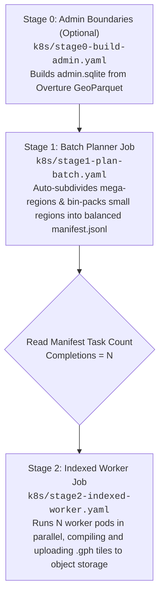

# Kubernetes Manifest Templates (`k8s/`)

This directory contains standalone Kubernetes Job and ServiceAccount manifests for running ValhallaRoute's distributed tile generation pipeline.

---

## Architecture & Stages



---

## File Reference

| File | Kubernetes Kind | Description |
| :--- | :--- | :--- |
| [`serviceaccount.yaml`](file:///C:/Users/jhees/PycharmProjects/ValhallaRoute/k8s/serviceaccount.yaml) | `ServiceAccount` | Configures Azure Workload Identity (or AWS IRSA) for passwordless cloud storage access. |
| [`stage0-build-admin.yaml`](file:///C:/Users/jhees/PycharmProjects/ValhallaRoute/k8s/stage0-build-admin.yaml) | `Job` | *(Optional standalone)* Compiles SpatiaLite `admin.sqlite` directly from Overture GeoParquet. |
| [`stage1-plan-batch.yaml`](file:///C:/Users/jhees/PycharmProjects/ValhallaRoute/k8s/stage1-plan-batch.yaml) | `Job` | Discovers regions on Geofabrik, performs tile workload balancing, and outputs `manifest.jsonl`. |
| [`stage2-indexed-worker.yaml`](file:///C:/Users/jhees/PycharmProjects/ValhallaRoute/k8s/stage2-indexed-worker.yaml) | `Job` (`Indexed`) | Worker job fanning out across $N$ tasks to compile and upload routing tiles to blob storage. |

---

## Step-by-Step Execution Guide

### 1. Configure the ServiceAccount
Edit [`k8s/serviceaccount.yaml`](file:///C:/Users/jhees/PycharmProjects/ValhallaRoute/k8s/serviceaccount.yaml) with your Azure Managed Identity Client ID:
```yaml
annotations:
  azure.workload.identity/client-id: "YOUR-AZURE-CLIENT-ID"
```
Apply to your cluster:
```bash
kubectl apply -f k8s/serviceaccount.yaml
```

---

### 2. Run the Batch Planner (Stage 1)
Edit [`k8s/stage1-plan-batch.yaml`](file:///C:/Users/jhees/PycharmProjects/ValhallaRoute/k8s/stage1-plan-batch.yaml) to configure:
- `--regions`: Extract names or wildcards (`"europe/*"`, `"germany/*"`, `"california"`, etc.).
- `--manifest`: Destination URI for the JSONL manifest (e.g. `azure://valhalla-tiles/manifests/europe.jsonl`).
- `--output`: Destination prefix for `.gph` tiles (e.g. `azure://valhalla-tiles/global/`).
- `--max-tiles`: Auto-subdivision threshold (default: `300`).
- `--target-tiles`: Target tile count per worker task during bin-packing (default: `200`).
- `--min-tiles`: Threshold below which extracts are bin-packed (default: `50`).
- `--admin-boundaries`: Automatically compile `admin.sqlite` from Overture GeoParquet during the planning phase.

Submit and wait for completion:
```bash
kubectl apply -f k8s/stage1-plan-batch.yaml
kubectl wait --for=condition=complete job/valhallaroute-plan-batch --timeout=15m
```

---

### 3. Launch the Indexed Worker Job (Stage 2)
Count the generated tasks in the manifest to determine `completions`:

#### Using bash / azcopy / curl:
```bash
# 1. Inspect total tasks generated in manifest
TASK_COUNT=$(az storage blob download --account-name valhallastorage --container valhalla-tiles \
  --name manifests/europe.jsonl --file /dev/stdout 2>/dev/null | grep -c '^{')

echo "Generated $TASK_COUNT balanced worker tasks."

# 2. Update completions dynamically and apply
sed -i "s/completions: .*/completions: $TASK_COUNT/" k8s/stage2-indexed-worker.yaml
kubectl apply -f k8s/stage2-indexed-worker.yaml
```

#### Using Python (Airflow / Dagster / Script):
```python
import smart_open
from kubernetes import client, config

# 1. Count tasks
with smart_open.open("azure://valhalla-tiles/manifests/europe.jsonl") as f:
    task_count = sum(1 for line in f if line.strip())

# 2. Submit Job
config.load_kube_config()
job_manifest = yaml.safe_load(open("k8s/stage2-indexed-worker.yaml"))
job_manifest["spec"]["completions"] = task_count
client.BatchV1Api().create_namespaced_job(namespace="default", body=job_manifest)
```

---

## Worker Pod Sizing (Guaranteed QoS)

The worker template is configured for Kubernetes **Guaranteed QoS** based on hard OS kernel benchmarks:
```yaml
resources:
  requests:
    cpu: "8"
    memory: "16Gi"
  limits:
    cpu: "8"
    memory: "16Gi"
volumeMounts:
  - name: build-scratch
    mountPath: /tmp/valhalla-build
volumes:
  - name: build-scratch
    emptyDir: {}
```
- Equal `requests` and `limits` ensure full CPU allocation without CFS throttling and prevent OOM-killing under node memory pressure.
- `emptyDir: {}` volume mount prevents large extracts from filling up root container overlay filesystems.
